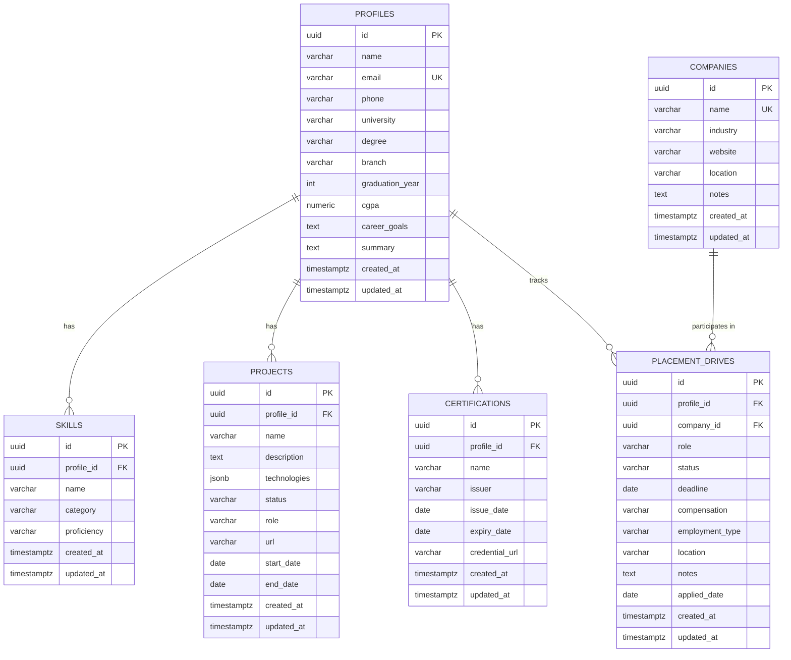

# Database Schema Documentation — Karthik AI

This document outlines the relational database schema implemented in **Phase 2** for Karthik AI using **PostgreSQL** and **SQLAlchemy**.

---

## 1. Entity-Relationship Overview



---

## 2. Table Specifications

### `profiles`
Stores user profile information, educational background, academic metrics, and career ambitions.
- **Primary Key:** `id` (UUID)
- **Unique Constraint:** `email`
- **Cascade Behavior:** Deleting a profile cascades to associated skills, projects, certifications, and placement drives.

### `skills`
Stores competencies, tools, languages, and frameworks.
- **Primary Key:** `id` (UUID)
- **Foreign Key:** `profile_id` references `profiles.id` (ON DELETE CASCADE)
- **Unique Constraint:** `(profile_id, name)` prevents duplicate entries per profile.

### `projects`
Tracks portfolio and academic projects.
- **Primary Key:** `id` (UUID)
- **Foreign Key:** `profile_id` references `profiles.id` (ON DELETE CASCADE)
- **Technologies:** JSONB array (e.g. `["Python", "FastAPI", "React", "PostgreSQL"]`).
- **Status values:** `planned`, `in_progress`, `completed`.

### `certifications`
Tracks professional certifications, licenses, and badges.
- **Primary Key:** `id` (UUID)
- **Foreign Key:** `profile_id` references `profiles.id` (ON DELETE CASCADE)

### `companies`
Reference dictionary of employers and target companies.
- **Primary Key:** `id` (UUID)
- **Unique Constraint:** `name`

### `placement_drives`
Tracks recruitment rounds, applications, status, compensation, and deadlines.
- **Primary Key:** `id` (UUID)
- **Foreign Keys:**
  - `profile_id` references `profiles.id` (ON DELETE CASCADE)
  - `company_id` references `companies.id` (ON DELETE CASCADE)
- **Status Progression:** `interested` -> `applied` -> `shortlisted` -> `interview_scheduled` -> `interviewed` -> `offered` -> `accepted` / `rejected` / `withdrawn`.

---

## 3. Database Migrations
Migrations are managed with **Alembic**.

To generate a new migration:
```bash
alembic revision --autogenerate -m "description"
```

To apply migrations:
```bash
alembic upgrade head
```
