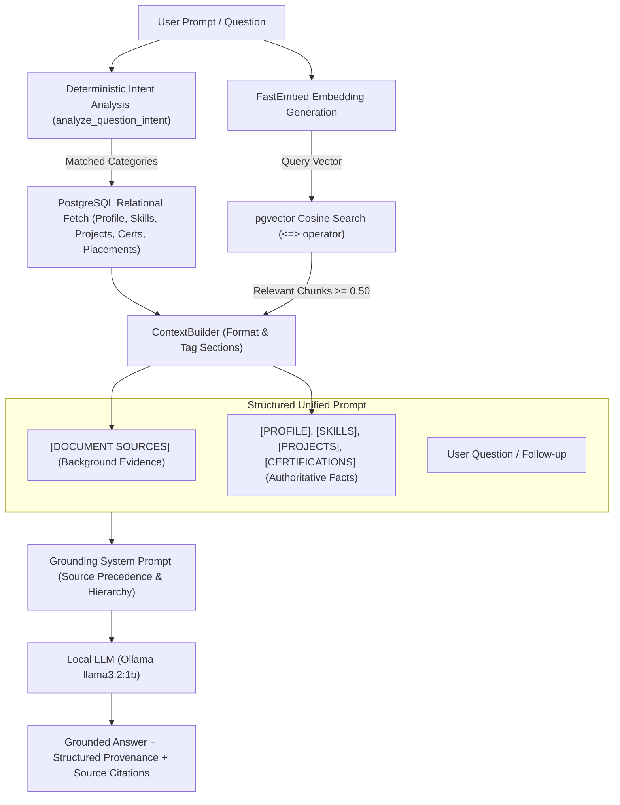

# Personal Memory & Profile Intelligence — Karthik AI (Phase 6)

Phase 6 upgrades Karthik AI from a document-only RAG engine into a **personal-context-aware AI assistant**.

The system unifies:
1. **Authoritative Structured Facts** stored in PostgreSQL (relational tables).
2. **Semantic Knowledge & Text Passages** retrieved from pgvector (vector embeddings).
3. **Multi-turn Conversation History** stored in PostgreSQL (`conversations` and `messages`).
4. **Local LLM Reasoning & Generation** (Ollama `llama3.2:1b` / configured provider).

---

## 1. Core Architectural Principle

```
STRUCTURED FACTS            → PostgreSQL (Authoritative, Zero-drift)
SEMANTIC DOCUMENT KNOWLEDGE → pgvector (Dense cosine similarity retrieval)
CONVERSATION MEMORY         → PostgreSQL (Relational JSONB history)
LLM                         → Reasoning, Synthesis, and Grounded Generation
```

### Why Structured Facts Are NOT Stored as Vector Embeddings
- **Zero Hallucination on Core Credentials:** Crucial metrics such as CGPA, university name, degree, active job application statuses, and skill levels must never depend on probabilistic vector similarity thresholds or chunk boundary luck.
- **Immediate Update Consistency:** When the user updates their CGPA or adds a project in PostgreSQL, the change takes effect immediately across all future queries with zero re-embedding overhead.
- **Relational Integrity:** Foreign keys, cascades, and data types (e.g., `Numeric(4,2)` for CGPA, `Date` for deadlines) ensure rigorous validation that vector databases cannot enforce.

---

## 2. Architecture & Request Pipeline



---

## 3. Deterministic Intent Analysis

Rather than incurring an extra round-trip LLM classification call on every query, `analyze_question_intent` employs regex pattern matching to route queries to context categories:

| Target Category | Trigger Patterns & Keywords | Structured Tables Queried |
|---|---|---|
| `profile` | `cgpa`, `gpa`, `marks`, `university`, `college`, `degree`, `branch`, `acm`, `role in` | `profiles` |
| `skills` | `skills`, `tech stack`, `technologies`, `languages`, `frameworks`, `proficiency` | `skills` |
| `projects` | `projects`, `built`, `developed`, `carbon footprint`, `portfolio`, `codebase` | `projects` |
| `certifications`| `certifications`, `certs`, `certified`, `credentials`, `badges`, `licenses` | `certifications` |
| `placements` / `companies` | `placement`, `drives`, `interview`, `applied`, `deadline`, `salary`, `package`, `google` | `companies`, `placement_drives` |
| `holistic advice` | `improve for placement`, `preparation plan`, `review my profile`, `readiness` | All structured tables |

---

## 4. Context Builder & Priority Ordering

The `ContextBuilder` (`backend/app/services/context_builder.py`) formats retrieved data into clean, bracket-delimited sections:

1. **`[DOCUMENT SOURCES]`** (placed first): Provides detailed implementation specifics, project reports, and resume wording as background reference.
2. **`[PROFILE]`**: Name, university, degree, branch, graduation year, CGPA, career goals.
3. **`[SKILLS]`**: Grouped by category with proficiency level.
4. **`[PROJECTS]`**: Role, status, description, and technologies.
5. **`[CERTIFICATIONS]`**: Issuer and issue date.
6. **`[COMPANIES & PLACEMENT DRIVES]`**: Target companies, roles, package, and application deadlines.

### Precedence & Recency Bias Mitigation
By placing the authoritative structured personal context **after** the document snippets and immediately adjacent to the `User Question`, local LLMs prioritize current relational facts over older or superseded document text.

---

## 5. Grounding System Prompt & Safeguards

The system prompt enforces strict rules:

1. **Structured Data Priority:** Structured facts in PostgreSQL are the primary source of truth. If a document snippet conflicts with the structured profile (e.g., an older resume with a previous CGPA), the structured profile **always takes precedence**.
2. **Direct Concise Answers:** Direct queries (e.g., "What is my CGPA?") receive direct, concise answers without lectures or conversational filler.
3. **Structured Advice Structure:** Open-ended placement preparation questions are formatted into:
   - `FACTS`: Verified background and skills.
   - `OBSERVATIONS`: Objective strengths and areas for improvement.
   - `RECOMMENDATIONS`: Actionable next steps.
4. **Hallucination Guard:** If neither structured tables nor uploaded documents contain the requested information, the model states:
   > *"Based on your personal profile and uploaded documents, there is not enough information to answer this question."*

---

## 6. API Endpoints

### Single-Turn Query
`POST /api/rag/query`
```json
{
  "question": "What is my CGPA?",
  "top_k": 3,
  "similarity_threshold": 0.50
}
```
**Response:**
```json
{
  "query": "What is my CGPA?",
  "answer": "Based on your verified personal context, your CGPA is 8.5/10.",
  "sources": [],
  "structured_sources": ["profile"],
  "model": "llama3.2:1b",
  "context_used": true,
  "grounded": true
}
```

### Multi-Turn Conversational Chat
`POST /api/rag/chat`
```json
{
  "message": "What is my degree and university?",
  "conversation_id": "optional-uuid"
}
```

### Real-Time Context Summary
`GET /api/rag/context-summary?question=What+are+my+skills%3F`
```json
{
  "profile_present": true,
  "profile_name": "Karthik",
  "skills_count": 3,
  "projects_count": 1,
  "certifications_count": 1,
  "companies_count": 1,
  "placements_count": 1
}
```
