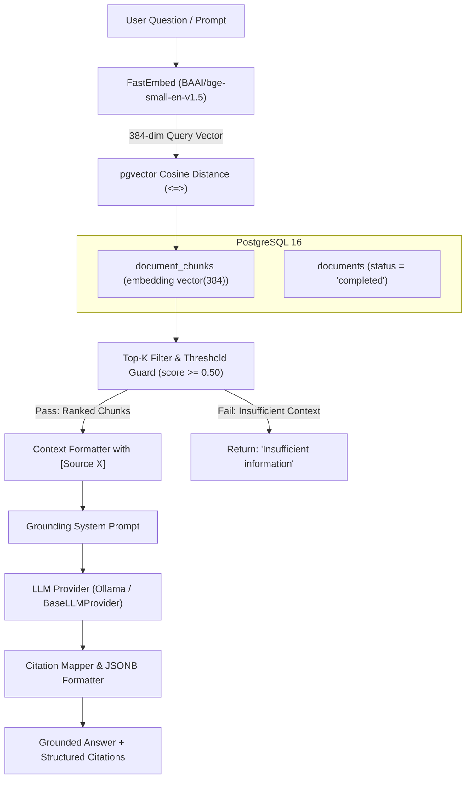

# RAG Retrieval & Answer-Generation Architecture — Karthik AI

Phase 4 implements the single-turn and multi-turn Retrieval-Augmented Generation (RAG) engine connecting user queries with personal documents stored in **PostgreSQL + pgvector**.

---

## 1. Overview Architecture



---

## 2. Mathematical Foundation: Cosine Distance & Similarity

When text chunks are ingested, they are converted into unit-normalized 384-dimensional dense vectors $\vec{v}$.

In pgvector, the distance operator `<=>` calculates the **cosine distance**:
$$\text{Cosine Distance}(\vec{u}, \vec{v}) = 1 - \frac{\vec{u} \cdot \vec{v}}{\|\vec{u}\| \|\vec{v}\|}$$

We compute **Cosine Similarity** directly as:
$$\text{Similarity Score} = 1 - (\text{embedding} \Leftrightarrow \text{query\_vector})$$

Chunks are retrieved using exact nearest-neighbor search:
```sql
SELECT 
    dc.id,
    dc.document_id,
    dc.chunk_index,
    dc.content,
    dc.page_number,
    d.original_filename,
    1 - (dc.embedding <=> :query_vector) AS similarity_score
FROM document_chunks dc
JOIN documents d ON dc.document_id = d.id
WHERE d.status = 'completed'
ORDER BY dc.embedding <=> :query_vector ASC
LIMIT :top_k;
```

---

## 3. Configuration & Parameter Tuning

The pipeline is governed by settings in `.env`:

| Parameter | Default | Purpose & Tuning Strategy |
|---|---|---|
| `LLM_PROVIDER` | `ollama` | Configurable provider (`ollama`, `mock`, extensible to `gemini`) |
| `OLLAMA_MODEL` | `llama3.2:1b` | Target local quantized model |
| `RAG_TOP_K` | `5` | Maximum number of chunks injected into the context window |
| `RAG_SIMILARITY_THRESHOLD` | `0.50` | Minimum similarity floor before dropping irrelevant passages |

> **Note on Threshold Tuning**:  
> `0.50` is an initial baseline suitable for dense semantic retrieval with `bge-small-en-v1.5`. Depending on dataset characteristics and domain vocabulary, this value should be tuned based on precision/recall evaluation.

---

## 4. Grounding Safeguards & Limitations

### Safeguards Implemented:
1. **Relevance Threshold Guard**: If no retrieved passages meet the minimum similarity threshold, retrieval immediately short-circuits. The system returns:
   > *"Based on your uploaded documents, there is not enough information to answer this question."*
2. **Grounding-Focused System Prompt**: Explicit instructions forbidding external assumptions, ungrounded speculation, or unstated facts.
3. **Structured Citation Verification**: Every citation object returned in the API payload is validated to match an actual chunk in the database with original filename, page/slide number, and snippet.

### Grounding Limitations:
- No prompt engineering or retrieval technique guarantees **100% zero hallucinations**. Small models can occasionally misattribute statements or conflate distinct passages.
- Ingestion extraction quality dictates retrieval accuracy: poorly formatted tables or scanned images without OCR will yield degraded chunks.

---

## 5. API Endpoints

- `POST /api/rag/query`: Single-turn grounded retrieval and response.
- `POST /api/rag/chat`: Multi-turn conversational RAG with conversation memory.
- `GET /api/rag/conversations`: List active chat threads.
- `GET /api/rag/conversations/{id}`: Retrieve message history with stored citations.
- `DELETE /api/rag/conversations/{id}`: Delete chat thread and cascade messages.
- `GET /api/rag/provider`: Provider health check and active configuration.
